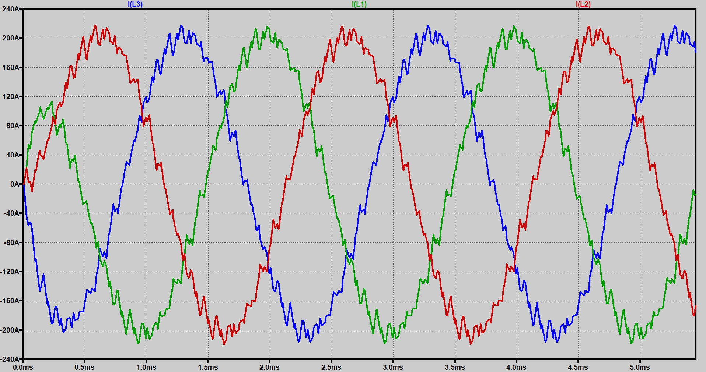
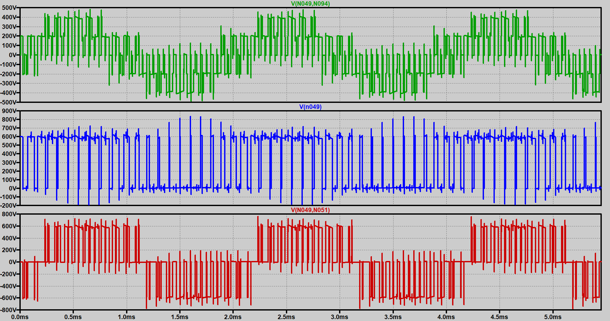
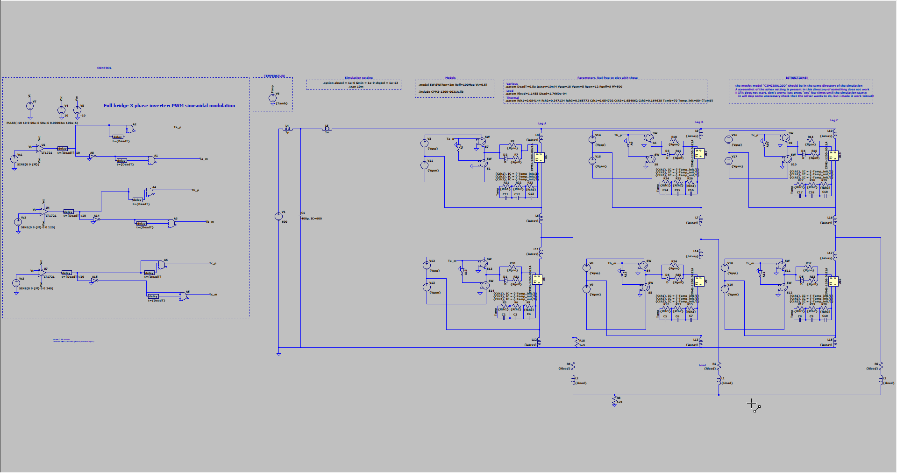

# Three-phase inverter in LTspice

Open-loop simulation of a three-phase voltage-source inverter. The schematic uses sinusoidal PWM, a SiC MOSFET model, an LR load, and a simple Foster thermal network taken from a commercial liquid-cooled power module.

The point of the model is to see how current, pole voltage, and line-to-line voltage move together when the load, switch, or modulation index changes.

## Operating point

| Name | Value |
| --- | --- |
| CosPhi | 0.9 |
| Modulation index | 0.9 |
| Irms | 150 A |
| Fundamental frequency | 500 Hz |
| Switching frequency | 10 kHz |
| Vdc | 600 V |

The switches are Wolfspeed CPM3-1200-0021A SiC MOSFET bare dice (1200 V, 100 A), with a simple gate drive.

## How to run

1. Install [LTspice](https://www.analog.com/en/resources/design-tools-and-calculators/ltspice-simulator.html).
2. Open `Three-phase-full-bridge-inverter.asc`.
3. Run the simulation.

Keep `CPM3-1200-0021A.asy` and `CPM3-1200-0021A.lib` in the same folder as the schematic. `settings_screenshot` shows the solver options (`SPICE.png`) and the compatibility options (`Hacks.png`) used for this file.

If LTspice stops on a check at startup, press Esc until the run continues. To change the load, edit the values in `Calculations.m`, then enter the resulting R and L into the schematic.

## Screenshots

Phase currents:

Phase, pole, and line-to-line voltage:

Schematic:

## Files

| File | Role |
| --- | --- |
| `Three-phase-full-bridge-inverter.asc` | Inverter schematic |
| `CPM3-1200-0021A.lib` / `.asy` | MOSFET model and symbol |
| `Calculations.m` | Load calculation for the R and L values |
| `Datasheet mos` | Wolfspeed CPM3-1200-0021A datasheet |
| `Screenshots` | Current, voltage, and schematic captures |
| `settings_screenshot` | Solver settings used for the run |

## References

- [CPM3-1200-0021A](https://www.wolfspeed.com/products/power/sic-bare-die-mosfets/1200v-bare-die-silicon-carbide-mosfets-gen3/cpm3-1200-0021a/)
- [Wolfspeed LTspice models](https://www.wolfspeed.com/tools-and-support/power/ltspice-and-plecs-models/)

## License

CC0 1.0. See [LICENSE](LICENSE).
